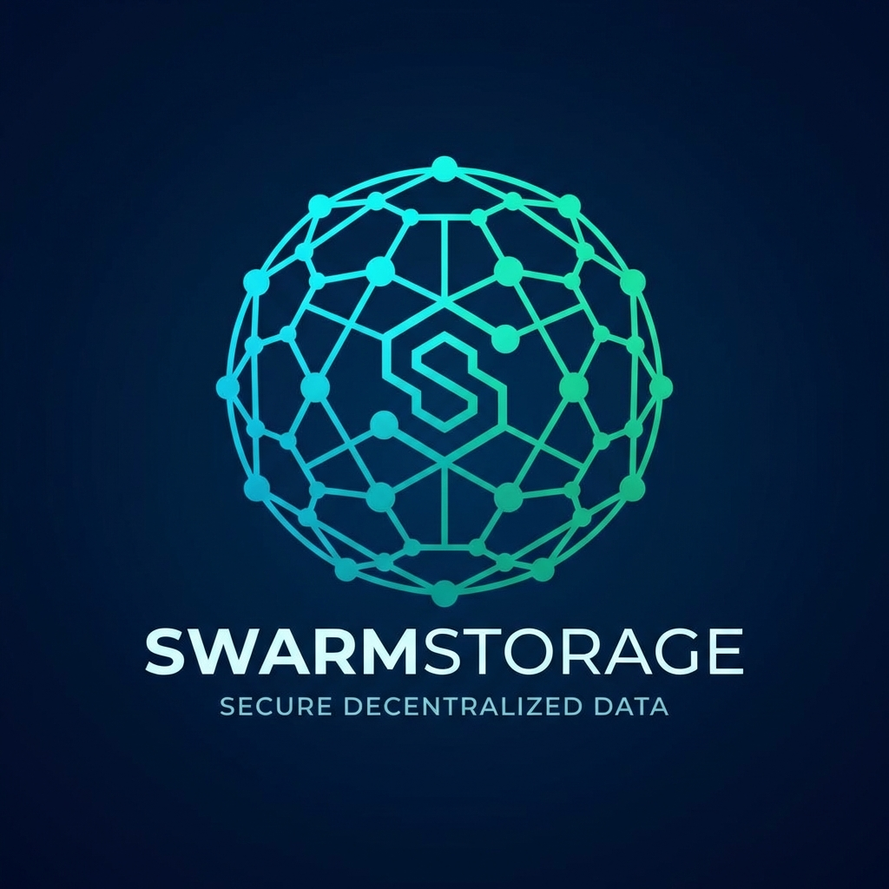
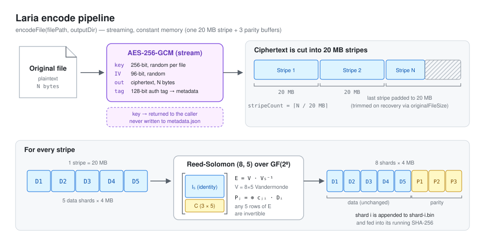
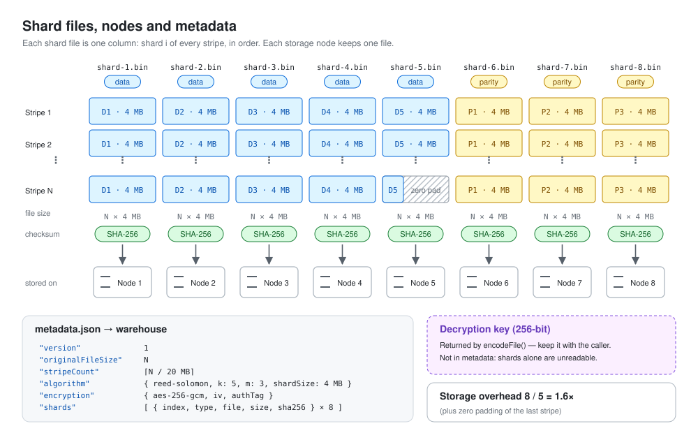
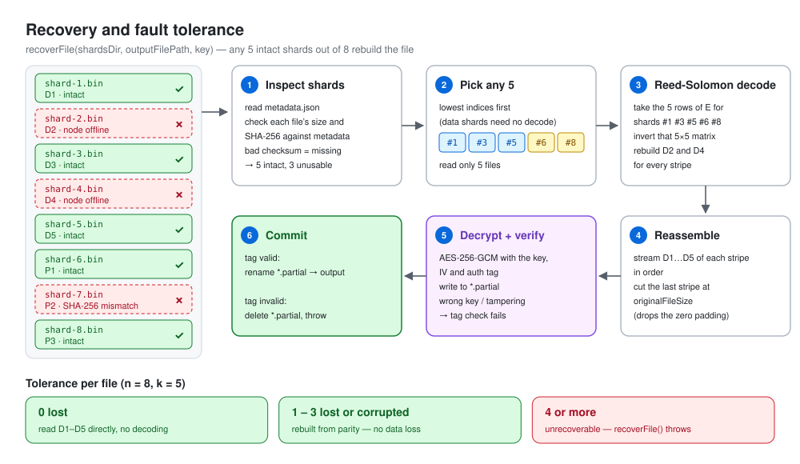

<div align="center">
  
  <h1>SwarmStorage</h1>
  <p><strong>Private IPFS Storage Cluster</strong></p>
</div>

## Overview

SwarmStorage is a decentralized, private storage solution designed for secure and redundant data management. It leverages a custom engine named **Laria** to ensure data durability and confidentiality through advanced sharding and encryption techniques.

## Key Features

- **Private & Secure**: Data is encrypted and distributed across a private cluster.
- **High Availability**: Resilient to node failures via Reed-Solomon erasure coding.
- **Distributed Architecture**: Decentralized storage nodes participating in a swarm.
- **Reward System**: Incentive mechanism for nodes verifying and storing data shards.

## Laria Engine

Laria ([`src/lib/laria.ts`](src/lib/laria.ts)) is the core storage engine powering SwarmStorage. It encrypts a file, splits it into erasure-coded shards, and rebuilds it from any 5 of the 8 shards. All processing is streamed, so memory use stays constant (one 20 MB stripe plus three 4 MB parity buffers) regardless of file size.

### How it Works

1.  **Encryption**: The file is encrypted with **AES-256-GCM** as a stream. A random 256-bit key is generated per file (or supplied by the caller) and returned to the caller — it is **never** written to the metadata. The 96-bit IV and 128-bit authentication tag are stored in the metadata. The ciphertext has the same length as the original file.
2.  **Striping & Padding**: The ciphertext is cut into **20 MB** stripes (Data Stripe Size). The last stripe is zero-padded to 20 MB; the padding is trimmed on recovery using `originalFileSize`.
3.  **Sharding (Reed-Solomon 8, 5)**:
    - Each stripe is divided into **5 data shards** of **4 MB** (Atomic Shard Size).
    - **3 parity shards** are computed with Reed-Solomon (8, 5) erasure coding over GF(2⁸) ([`src/lib/reed_solomon_erasure.ts`](src/lib/reed_solomon_erasure.ts)). The encoding matrix is derived from a Vandermonde matrix so that data shards stay unchanged and any 5 of the 8 shards are enough to rebuild the rest.
4.  **Shard Files & Distribution**: Shard *i* of every stripe is appended to `shard-i.bin`, and a SHA-256 checksum is computed for each file. The 8 shard files are distributed to different storage nodes in the network.
5.  **Metadata**: `metadata.json` records the file size, stripe count, algorithm parameters, IV, auth tag and each shard's size and SHA-256. It is stored in the warehouse.

<p align="center">
  
</p>

<p align="center">
  
</p>

> Storage overhead is 8 / 5 = **1.6×** the file size (plus the zero padding of the last stripe).

### Recovery

1.  **Inspect**: Every shard file is checked against the size and SHA-256 recorded in `metadata.json`. A missing or corrupted shard is treated as lost.
2.  **Select**: Any **5** intact shards are enough. Data shards are preferred, so when all 5 are intact no decoding is needed.
3.  **Decode**: Reed-Solomon rebuilds the missing data shards stripe by stripe.
4.  **Reassemble**: Data shards are streamed in order and the last stripe is trimmed to `originalFileSize`.
5.  **Decrypt & Verify**: AES-256-GCM decrypts into a temporary `*.partial` file. Only if the authentication tag verifies is it renamed to the output path; a wrong key or tampered data leaves no output behind.

<p align="center">
  
</p>

| Shards lost or corrupted | Shards intact | Result |
|---|---|---|
| 0 | 8 | ✅ Read data shards directly |
| 1 – 3 | 7 – 5 | ✅ Rebuild missing shards from parity |
| 4 or more | 4 or fewer | ❌ Unrecoverable — `recoverFile()` throws |

### Usage

```typescript
import { encodeFile, recoverFile } from '@/lib/laria';

// Encrypt and shard: writes shard-1.bin … shard-8.bin and metadata.json
const { metadata, key } = await encodeFile('./video.mp4', './shards/video');
// Keep `key` (hex) safe — it is not stored in metadata.json

// Rebuild from any 5 intact shards
const result = await recoverFile('./shards/video', './restored.mp4', key);
console.log(result.usedShards, result.missingShards, result.reconstructed);
```

## Tech Stack

- **Frontend/Framework**: [Next.js 16](https://nextjs.org/)
- **UI Library**: [React 19](https://react.dev/)
- **Styling**: [Tailwind CSS 4](https://tailwindcss.com/)
- **Blockchain Interaction**: [Ethers.js](https://docs.ethers.org/v6/)
- **Containerization**: Docker

## Getting Started

### Prerequisites
- Docker
- Node.js 24.22.1 (see `.nvmrc`)

### Installation & Run

```shell
# Install dependencies
npm install

# Start IPFS and local services
docker compose up -d

# Run the SwarmStorage service (Production build)
npm run swarm
# OR for development
npm run dev
```

## Sign in with CAFECA

Sign-in is optional: without it DropHere works anonymously with a per-browser identity. Signing in with [CAFECA](https://github.com/CAFECA-IO/CAFECA) (Passkey-based digital identity) makes rooms and uploads follow the user across devices and shows their CAFECA handle in chat, calls and the uploader field. Rooms and files created anonymously in the same browser are merged into the account on first sign-in.

No registration with CAFECA or API key is needed. The user signs an EIP-712 message bound to this site's origin in the CAFECA wallet; the server verifies it itself by calling the identity contract's `isValidSignature` (ERC-1271) over the public RPC, then issues an `httpOnly` session cookie (30 days). The verifier in `src/lib/cafeca/` is copied unchanged from the CAFECA repository.

| Variable | Default | Description |
|----------|---------|-------------|
| `PUBLIC_ORIGIN` | (unset) | Site origin(s) users sign in from, comma separated, e.g. `https://drophere.io`. **Required in production**; when unset only `localhost` can sign in |
| `CAFECA_WALLET` | `https://cafeca.io` | CAFECA wallet origin; `off` disables sign-in |
| `CAFECA_RPC_URL` | wallet's public RPC | Optional own Boltchain RPC for signature checks |
| `SESSION_SECRET` | auto-generated | Session cookie signing key (≥ 32 chars). When unset a random key is created in `.drophere/session.key`; replace it to sign everyone out |

| API | Description |
|-----|-------------|
| `POST /api/v1/auth/cafeca/nonce` | One-time nonce bound to the browser (5 minutes) |
| `POST /api/v1/auth/cafeca/login` | Verify the wallet response and start a session |
| `GET /api/v1/auth/session` | Current user `{ account, handle }` or `null` |
| `DELETE /api/v1/auth/session` | Sign out |

## API Reference

### Upload File
**POST** `/api/v1/file`

Uploads a file to the swarm. The file will be processed by the Laria engine.

### Download File
**GET** `/api/v1/file/:cid`

Downloads a file or shard by its Content Identifier (CID). If the CID points to an encrypted file metadata, Laria will automatically attempt to fetch shards and reconstruct the original file.

